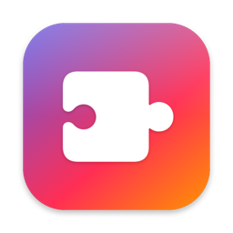
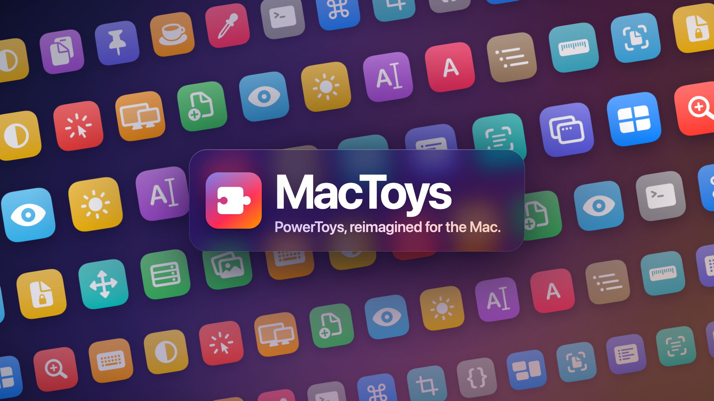

<p align="center">
  
</p>

<h1 align="center">MacToys</h1>

<p align="center">
  <b>为 Mac 重新打造的 PowerToys。</b><br>
  31 个效率工具，集成在一个原生的 macOS 26 菜单栏应用里。
</p>

<p align="center">
  <a href="README.md">English</a> ·
  <a href="#安装">安装</a> ·
  <a href="#工具一览">工具一览</a> ·
  <a href="#命令行">命令行</a> ·
  <a href="CONTRIBUTING.md">参与贡献</a>
</p>

<p align="center">
  
</p>

MacToys 把 [Microsoft PowerToys](https://github.com/microsoft/PowerToys) 0.102 的全部工具带到了 macOS：
FancyZones 窗口布局、Command Palette 启动器、取色器、OCR 文字识别、ZoomIt、PowerRename 批量改名、
Keyboard Manager 按键重映射、一组鼠标工具、面向开发者文件的 Quick Look 预览等等。它用 Swift 和 SwiftUI 编写，
遵循 macOS 的使用习惯（菜单栏、Liquid Glass、系统设置风格的设置页），并提供 11 种界面语言。

MacToys 是独立项目，与 Microsoft 没有任何关联。

## 安装

目前还没有签名发布版，需要从源码构建：

```bash
git clone https://github.com/Last-emo-boy/mactoys.git
cd mactoys
scripts/run.sh            # 构建、本地签名、安装到 ~/Applications 并启动
```

需要 macOS 26 或更高版本、Xcode 27（Swift 6.4）。Power Display 控制外接显示器需要 Apple 芯片；
其余功能从源码构建后在 Intel Mac 上同样可用。

`scripts/run.sh` 会在单独的钥匙串里创建一个自签名的 “MacToys Dev” 证书来签名，
所以每次重新构建后，你授予的系统权限依然有效。

### 系统权限

每种权限 macOS 只会询问一次。没有任何权限时 MacToys 也能运行；需要权限的工具会在设置页顶部显示提示和
**授予权限** 按钮。

| 权限 | 用途 |
|---|---|
| 辅助功能 | 移动窗口、全局快捷键、按键重映射 |
| 输入监控 | Quick Accent、鼠标工具 |
| 屏幕录制 | Color Picker、Screen Ruler、Text Extractor、ZoomIt、Always On Top、Crop And Lock |
| 自动化 | 读取 Finder 选中的文件（Peek、PowerRename、New+）、切换外观 |
| 麦克风（可选） | ZoomIt 录音和截图听写 |
| 定位（可选） | Light Switch 的日出日落时间 |
| 完全磁盘访问（可选） | File Locksmith 查看受保护的文件 |

## 工具一览

**系统工具**：Advanced Paste（多种格式粘贴、AI 转换）、Awake（保持唤醒）、Color Picker（取色器）、
Command Not Found（命令不存在时推荐 Homebrew 包）、Command Palette（统一搜索框）、Light Switch（自动深浅色）、
Power Display（显示器亮度音量输入源）、Run（关键字启动器）、Screen Ruler（屏幕标尺）、
Shortcut Guide（快捷键速查）、Text Extractor（OCR 取字）、ZoomIt（缩放标注录屏）。

**窗口与布局**：Always On Top（窗口置顶）、Crop And Lock（裁剪窗口成实时缩略图）、FancyZones（窗口分区布局）、
Grab And Move（按住修饰键拖动窗口）、Window Hopper（在同一应用的窗口间切换）、Workspaces（一键恢复应用布局）。

**输入与输出**：Keyboard Manager（按键与快捷键重映射）、Mouse Utilities（找鼠标、点击高亮、跨屏跳转、十字准线等七项）、
Mouse Without Borders（多台 Mac 共用一套键鼠）、Quick Accent（长按输入带重音的字符）。

**文件管理**：Finder Add-ons（Quick Look 预览与缩略图）、File Locksmith（查看谁在占用文件）、Image Resizer（批量缩放图片）、
New+（从模板新建文件）、Peek（快速预览）、PowerRename（批量改名）。

**高级**：Environment Variables（环境变量与配置组）、Hosts File Editor（编辑 /etc/hosts）、Plist Preview（属性列表与 defaults 编辑）。

完整说明和默认快捷键见 [英文 README](README.md#utilities)。

### 与 Windows 版的差异

- **Always On Top**：macOS 不允许一个应用改变其他应用窗口的层级，所以用实时镜像让置顶窗口保持在最前，
  鼠标移上去时把真正的窗口调到原位。
- **Crop And Lock**：macOS 不能嵌入其他应用的窗口，可交互裁剪会在你点击时把原窗口移到裁剪区域下方。
- **Registry Preview** 变成 **Plist Preview**；**文件资源管理器加载项** 变成 **Finder Add-ons**（Quick Look 扩展）；
  **Command Not Found** 在 zsh 中推荐 Homebrew 包。
- **Power Display** 在 Apple 芯片上通过 IOAVService 走 DDC/CI；屏幕旋转没有公开 API，只读显示。
- **Mouse Without Borders** 在 Mac 之间连接（加密、Bonjour 自动发现），不与 Windows 版互通。

## 命令行

`mactoys` 命令行工具随应用一起提供（`MacToys.app/Contents/Helpers/mactoys`），在 **设置 › 通用 › 命令行工具** 中可以链接到
`/usr/local/bin`。

```bash
mactoys modules                          # 列出所有工具及开关状态
mactoys paste json data.csv              # Advanced Paste 转换：plain-text、markdown、json……
mactoys resize *.heic --preset Medium    # Image Resizer
mactoys locksmith ~/Projects/build       # 哪些进程在使用这些文件
mactoys awake for 1:30                   # Awake、Light Switch、Power Display 都有完整的命令行
mactoys help
```

任意命令加 `--json` 可以输出 JSON。

## 语言

English、简体中文、繁體中文、日本語、한국어、Deutsch、Français、Español、Português (Brasil)、Italiano、Русский。
在 **设置 › 通用 › 语言** 中切换（或在系统设置 › 通用 › 语言与地区 › 应用中设置）。
翻译文件在 `Resources/Localization/Localizable.xcstrings`，改进翻译或新增语言见
[CONTRIBUTING.md](CONTRIBUTING.md#translations)。

## 构建与测试

```bash
swift build          # 构建所有目标
swift test           # 650+ 个单元测试
scripts/bundle.sh    # 生成 build/MacToys.app（CONFIG=release 为优化构建）
```

## 致谢

功能与行为参照 [Microsoft PowerToys](https://github.com/microsoft/PowerToys)（MIT）。
派生自其源码的部分列在 [THIRD_PARTY_NOTICES.md](THIRD_PARTY_NOTICES.md)。

## 许可证

[MIT](LICENSE)
